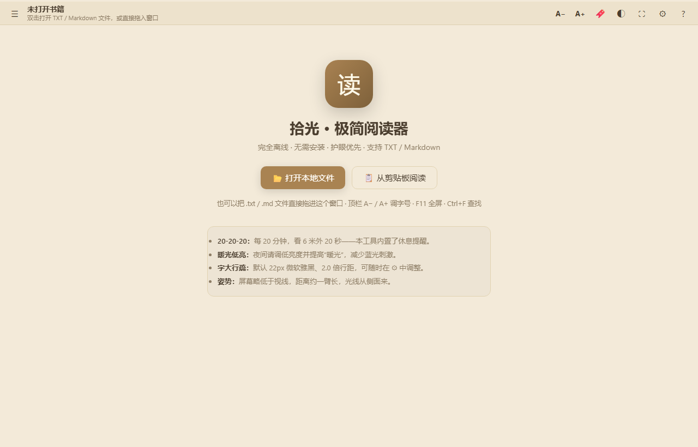

# 拾光 · 极简阅读器

一个**单文件、零依赖**的离线阅读器：所有代码都在一个 HTML 里，双击就能用，不需要安装任何东西。

## 功能

- **多编码嗅探**：BOM / UTF-8 / UTF-16LE / UTF-16BE，识别失败时回退 gbk / gb18030 / big5
- **迷你 Markdown 渲染**：标题、表格对齐、引用、围栏代码、嵌套列表、行内代码
- **横向分页阅读**：滚轮累积翻页 + 吸附，像翻书一样
- **最近打开**：用 IndexedDB 保存文件句柄，下次不必重新选文件
- **阅读进度 / 书签 / 批注**：存在 localStorage；划词标注用 `TreeWalker` 做文本偏移映射
- **专注模式**：夜间自动切换、定时休息提醒（WebAudio 提示音）

## 两种用法

| 文件 | 用法 |
|---|---|
| `reader.html` | 直接双击，用默认浏览器打开 |
| `reader.hta` | 双击后以「无边框应用窗口」启动（Windows） |

### 关于 `reader.hta`（请先读这段）

它是个**启动器**，不是可执行程序：内部用 base64 内嵌了一份应用代码，运行时把它解出来写到同目录的
`reader.html`，然后调用系统里的 `msedge.exe --app=file:///...` 以应用窗口打开；找不到 Edge 时回退到
`rundll32 FileProtocolHandler`。

之所以这样做，是为了"只发一个文件就能用"，同时保留应用窗口（无地址栏）的观感。
如果你不放心脚本行为，**直接双击 `reader.html` 即可**，功能完全一样。

> 提示：从网上下载的 `.hta` 常被 Windows 标记为"来自 Internet"，若提示被阻止，
> 右键文件 → 属性 → 勾选「解除锁定」。

## 技术点

- 单文件应用：HTML + 内联 CSS/JS，零依赖、零构建
- 编码嗅探与降级：先看 BOM，再按 UTF-8 严格解码试探，失败回退中文常见编码
- 不依赖任何阅读器控件：自己实现分页、进度与批注的持久化
- 批注定位：`TreeWalker` 遍历文本节点建立偏移量映射，避免破坏 DOM 结构

## 已知限制

- 只在 Windows + Edge/Chrome 上验证过；其他平台请用 `reader.html` 那一份
- 超大文件（几十 MB）的首屏解析会卡顿，未做流式加载
- 批注定位基于文本偏移，文档内容变化后偏移会失效

## License

MIT，见 [LICENSE](LICENSE)。
